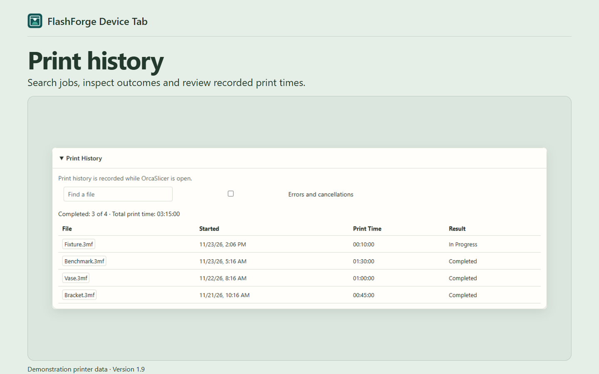

#  FlashForge Device Tab

Follow a FlashForge print from OrcaSlicer's **Device tab**. See how much time
is left, check nozzle and bed temperatures, or open the printer camera.
Switch between your local printers and review completed jobs after a restart.
Printers with a working authenticated control API also offer pause, resume and cancel.

**1.10.0 is the stable release.** The feature set is frozen. Future maintenance
is limited to bug fixes and compatibility updates for existing features.

[](docs/panel.png)

| All printers | Print history |
| --- | --- |
| [](docs/02-printer-fleet.png) | [](docs/03-print-history.png) |

The screenshots show the plugin running with demonstration data. Select an image for a closer look.

## What it does

- **Print job card** — file name, progress, remaining and elapsed time, layer.
- **Printer readings** — nozzle and bed temperature against their targets, fan
  and speed.
- **Temperatures chart** — the last 30 minutes, sampled every five seconds.
- **Camera** — the printer's MJPEG stream, if the printer exposes one.
- **Printer files** — the on-printer file list with previews, 10 per page.
- **Print history** — jobs with start, end, duration and result, kept on disk so
  it survives OrcaSlicer restarts.
- **Several printers** — every printer in the plugin settings is monitored. Open
  **All printers** to see them side by side or filter for attention, then open
  its full panel.
- **Pause, resume, cancel** — from the panel header. Cancel asks for a second
  click; nothing is sent until you confirm.
- **Printer card** — model, firmware, serial number, MAC, build volume and light
  when available.
- **Totals** — jobs, print time and success rate from the local history.
- **Save snapshot** — one camera frame, saved by the browser.
- **Host notifications** — “Print finished”, “Print cancelled”, “Printer error”
  appear in the 3D view, so you notice without watching the tab.

## Install

1. Download `flashforge_device_tab.py` from the latest release.
2. In OrcaSlicer open **Plugins → Install from file** and pick the file.
3. Enable **FlashForge Device Tab**.
4. Make sure the printer profile uses the **FlashForge** host type.
5. Open the **Device tab**. The plugin panel opens automatically for a configured
   FlashForge printer. For initial setup, use **Speed Dial → FlashForge Device Tab**.

OrcaSlicer 2.5.0 or newer, Windows x64. The plugin needs no extra software: no
Node, no Docker, no Raspberry Pi, no second application.

The selected Device page is remembered per printer profile and address. The plugin
restores it after restarting OrcaSlicer or selecting that profile, even if you did
not save the edited printer preset. **Printer Web Interface** switches back to the
native page and remembers that choice; **Speed Dial → FlashForge Device Tab**
switches back to the plugin panel.

## Settings

Open **Settings** and enter the printer address, optional display name, CheckCode
and serial number. **Check saved connection** reads status from the saved
device. **Edit as text** accepts one printer per line:

```
192.168.1.50 | 1a2b3c4d | Adventurer 5M
192.168.1.51 | 2b3c4d5e | Creator 5 Pro | YOUR-SERIAL-NUMBER
```

`address | CheckCode | name | serial number`. The name is optional and falls
back to the address. Use the CheckCode from the printer's network settings.

- **Adventurer 5M / 5M Pro** reads the serial number over TCP. Basic monitoring
  and the file catalog work without a CheckCode. Extra telemetry and job
  controls use the CheckCode.
- **Creator 5 / 5 Pro** requires the serial number and CheckCode. Enable LAN-only
  mode on stock firmware. The Device tab can read print status, temperatures,
  available progress and time fields, file names and thumbnails. It also uses
  the existing pause, resume and cancel controls. Creator support has been
  tested with a simulated printer.

On **Creator 5 Pro**, open **Camera → Connect** to start the built-in camera.
**Save snapshot** downloads the displayed JPEG while video continues. Closing
the Device tab releases the camera. Returning to the monitor reconnects when
the Camera panel is open. Choose **Disconnect** to turn off automatic reopening.

Creator stock firmware returns a list of file names and serves thumbnails
separately. It does not report the active tool, TCP endstops, or per-file material
and time estimates. The temperature chart compares the selected tool and the bed. The readings
panel also shows T2–T4 and the Pro chamber temperature when available. The
plugin does not upload files, start prints or change material mappings.

## Other FlashForge models

| Family | Compatibility evidence and scope |
| --- | --- |
| Adventurer 3 | Experimental progress and temperature parsing, tested locally with documented TCP replies. The panel can show a percentage when the firmware omits layers. Basic monitoring is the initial scope. [Firmware protocol reference](https://github.com/Parallel-7/flashforge-api-docs/blob/main/endpoints/networkserver_commands_adventurer3.yaml) |
| Adventurer 4 Pro / Lite | Candidates for the same monitoring path. Verify status, progress format and state transitions on each variant before claiming support. [Protocol reference](https://github.com/Parallel-7/flashforge-api-docs/wiki/Adventurer-4-Series) |
| AD5X | Experimental read-only display of four IFS slots when the status response includes station data. The material, color, occupancy and selected slot follow the reported fields. Tested with simulated data. Hardware verification is pending. [Protocol research](https://github.com/Parallel-7/flashforge-api-docs/wiki/AD5X-IFS-Material-Station) |
| Guider 3 Ultra | FlashForge lists this printer in Flash Studio Desktop. Compatibility with this plugin's LAN requests still needs sample responses. [Vendor software page](https://www.flashforge.com/pages/flash-studio-desktop) |
| Finder | An existing Cura integration provides a starting point for research. Identify the specific Finder generation and capture its monitoring responses before adding it here. [Finder integration](https://github.com/ronoaldo/FlashforgeFinderIntegration) |

For a compatibility report, include the exact model and firmware, which readings
appeared while idle and printing, and what the panel showed when the job ended.
Remove addresses, serial numbers and CheckCodes from any shared screenshots or logs.

## How it works

OrcaSlicer shows a plugin page in the Device tab when the printer profile's
`print_host_webui` points at it. The plugin runs a loopback HTTP server on
`127.0.0.1:18771` and renders a single HTML page. It tries FlashForge TCP on
port 8899 first. When that fails and the serial number and CheckCode are set,
it checks the HTTP API on port 8898 and keeps using it after a successful
status read. Creator cameras use a separate MJPEG stream on port 8080.

## Security

- The plugin talks to the printers you configured and to OrcaSlicer's UI. It
  never starts a print, never deletes files and never changes printer settings;
  the only write commands are pause, resume and cancel, and each one needs a
  click in the panel.
- Reads **only its own configuration** from OrcaSlicer; printer profiles are
  never read for credentials.
- Talks to the local network: the printers you configure, nothing else.
- Serves one page on `127.0.0.1`, checks `Host`, `Origin` and `Sec-Fetch-Site`,
  refuses framing from other origins and sends `no-store`.
- The OrcaSlicer plugin catalogue rates the plugin **low risk**.

## Development

```powershell
python -m unittest discover -s tests
node --test tests/panel-regressions.test.cjs
```

The tests use an Adventurer fixture with both transports and a Creator fixture
with HTTP only. They exercise status, files, thumbnails, job controls, LAN mode
and credential errors, history, settings and the Device page bridge.

With Chrome installed and the Playwright Node package available, run
`node tests/camera-browser.cjs` for the Creator 5 Pro camera lifecycle test.
It starts its own local printer simulator, compares the saved JPEG with the
displayed frame and checks the camera commands across closing and reopening
the browser tab.

## Releasing

1. Bump `# version` in `flashforge_device_tab.py` and add a `CHANGELOG.md` entry.
2. Commit, tag `vX.Y.Z`, push the tag.
3. Publish a GitHub release for the tag. `.github/workflows/publish-orcacloud.yml`
   uploads the plugin to the OrcaSlicer catalogue through GitHub OIDC — the tag
   becomes the published version and the release notes become the changelog.

The catalogue requires a platform suffix in the uploaded file name, so the
workflow sends `flashforge_device_tab_win_x86_64.py`.

## License

MIT. Community plugin, not affiliated with FlashForge or OrcaSlicer.
