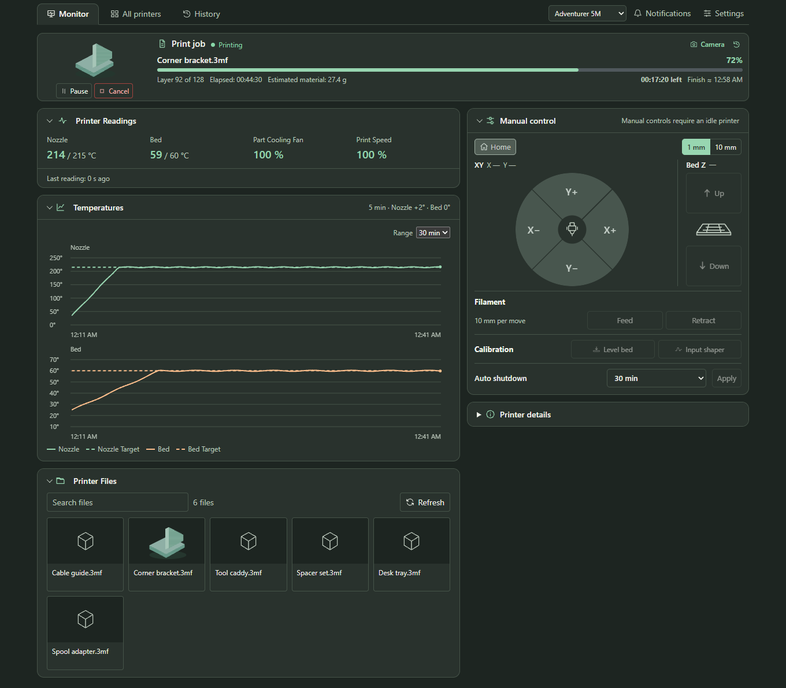
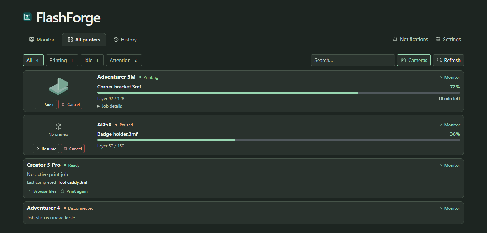
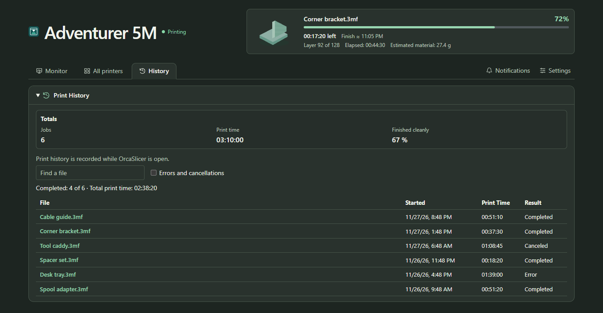
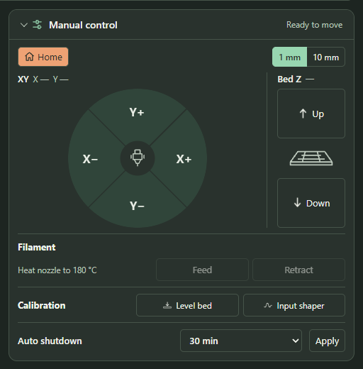
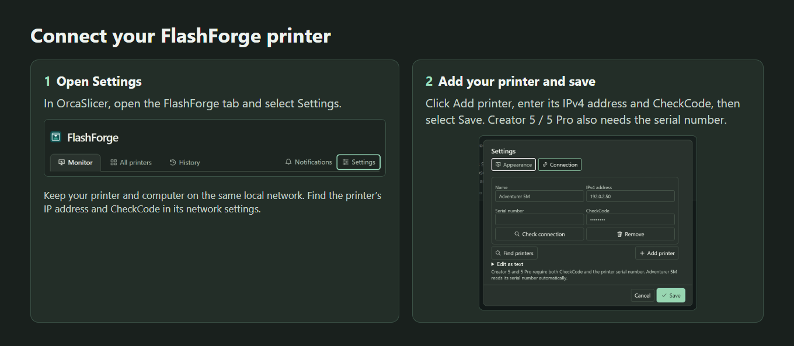

#  FlashForge Device Tab

Follow a FlashForge print from OrcaSlicer's **Device** or **FlashForge** tab. See how much time
is left, check nozzle and bed temperatures, or open the printer camera.
Switch between your local printers and review completed jobs after a restart.
Printers with a working authenticated control API also offer pause, resume and cancel.

**Version 1.14.3** resumes live monitoring after a successful connection check
following an access failure and preserves the original error if startup fails.

[](docs/orca-cloud/01-monitor.png)

| All printers | Print history |
| --- | --- |
| [](docs/orca-cloud/02-all-printers.png) | [](docs/orca-cloud/03-history.png) |

The screenshots show the plugin running with demonstration data. Select an image for a closer look.

[Monitor settings for temperature plots and readings](docs/orca-cloud/06-monitor-settings.png)

## Manual control by model



| Printer | Commands in the manual panel |
| --- | --- |
| Adventurer 3, 3 Lite, 3 Pro, 3 Pro 2, 4, 4 Pro and 4 Lite | Home, XYZ jogs (1 or 10 mm) via TCP. |
| Adventurer 5M and 5M Pro | Home, XYZ jogs, nozzle target (180–280 °C in 20 °C steps or off), and 10 mm feed/retract at a measured 180 °C or higher via TCP with authenticated telemetry. Level bed, input shaper and the firmware-reported shutdown timer via HTTP. |
| AD5X | Level bed, input shaper and the reported shutdown timer. Home, XYZ jogs, feed/retract and error clearing require firmware 1.1.6 or later and any applicable capability reported by the printer. |
| Creator 5 and Creator 5 Pro | Level bed, input shaper and the firmware-reported shutdown timer via HTTP. Stock firmware has no manual motion or extrusion API. |

Manual commands require an idle printer. Where available, the shutdown timer offers Off, 30, 60
and 120 minutes. The manual controls were verified with simulated printers.
TCP axis jogs check the current position against the model's print envelope
before sending a move. On AD5X, the plugin also checks the target when the
printer reports its position over TCP. HTTP-only AD5X setups keep the existing
jog controls and report when the plugin could not check the limits.
On the Adventurer 5M and 5M Pro, **Release motors** removes motor holding torque
while the printer is idle. The axes can move by hand. Manual movement stays
locked, including after reconnecting, until **Home** completes in the plugin.
Focus the XY pad to jog by 1 mm with the arrow keys or by 10 mm with Shift.
Press Enter on the Home button to home the printer. If readings become
unavailable, the panel stays open and commands are disabled until fresh readings arrive.

## What it does

- **Print job card** — file name, progress, remaining and elapsed time, layer.
- **Printer readings** — nozzle and bed temperature against their targets, fan
  and speed.
- **Temperatures chart** — the last 30 minutes, sampled every five seconds.
- **Camera** — the printer's MJPEG stream, if the printer exposes one.
- **Chamber light** — switch it from the Camera panel on authenticated Creator 5,
  Creator 5 Pro, and Adventurer 5M Pro printers that report its state.
- **Printer files** — the on-printer file list with previews, up to three rows per page.
  Select a file and choose **Print** to start it while the printer is idle.
  On an authenticated Adventurer 5M, **Upload file** saves prepared G-code or
  a sliced single-plate 3MF without starting a print. Newly detected files
  appear first, and the catalog remembers that order across restarts.
- **Material station** — view, then edit a slot's material and color while the
  printer and station are idle on supported AD5X and Creator 5 models.
- **Print history** — jobs from all configured printers and archived printers
  with local history files. Filter by printer or open a printer's own history
  from **Monitor**. Each record includes the start, end, duration and result.
- **Several printers** — **All printers** shows one row per configured printer,
  including idle and disconnected printers. Search by printer or job and
  filter by status. See progress, the model preview and the live camera for
  active jobs. Control camera playback for the whole list. On a ready printer,
  browse files or open print confirmation for its last completed job.
- **Pause, resume, cancel** — from the panel header. Cancel asks for a second
  click; nothing is sent until you confirm.
- **Printer card** — model, firmware, serial number, MAC, build volume and light
  when available.
- **Totals** — jobs, print time and success rate from the local history.
- **Save snapshot** — one camera frame, saved by the browser.
- **Host notifications** — “Print finished”, “Print cancelled”, “Printer error”
  appear in the 3D view, so you notice without watching the tab.
- **Settings** — **Appearance** offers theme and layout density. Open
  **Monitor**, **All printers**, **Printer Files** or **Print History** directly
  for settings specific to that area. **Connection** holds printer addresses
  and credentials.

## Install

1. Download `flashforge_device_tab.py` from the latest release.
2. In OrcaSlicer open **Plugins → Install from file** and pick the file.
3. Enable **FlashForge Device Tab**.
4. Open the separate **FlashForge** tab.
5. Open **Settings** in the monitor to configure your printer.

[](docs/orca-cloud/05-connect-printer.png)

OrcaSlicer 2.5.0 or newer, Windows x64. The plugin needs no extra software: no
Node, no Docker, no Raspberry Pi, no second application.

**Open Printer Interface in Browser** opens the printer's own web page in the
system browser and keeps the monitor open in OrcaSlicer. If an earlier release
left the Device tab on a connection error, the plugin restores the monitor
when it loads for the configured FlashForge profile.

## Settings

The plugin includes 24 interface languages and follows OrcaSlicer by default.
Use **Plugins → FlashForge Device Tab → Config → Interface language** to choose
a language explicitly. Save and reopen the monitor. Some OrcaSlicer 2.5.x builds
report a reduced set of languages through the plugin API, so an explicit
selection can be needed for languages such as Euskara or Traditional Chinese.

FlashForge uses the built-in **Printer** tab for FlashForge profiles by default.
Choose the separate **FlashForge** tab in **Settings → Monitor → Tab placement**,
save, then restart OrcaSlicer. Monitor settings also include the taller Print job
card, which is enabled by default.

On the first visit, the setup wizard asks where to show FlashForge and helps you
connect your first printer. If no FlashForge profile is selected, open the
**FlashForge Device Tab** action from Speed Dial to start setup.

Open **Settings** and enter the printer address, optional display name, CheckCode
and serial number. **Find printers** can fill the model, address, and reported
serial number for the 5M series, AD5X, and Creator 5 series on the local network.
**Check connection** tests the values in the form before saving. If discovery is
unavailable, enter the address manually. **Edit as text** accepts one printer per line:

```
192.168.1.50 | 1a2b3c4d | Adventurer 5M
192.168.1.51 | 2b3c4d5e | Creator 5 Pro | YOUR-SERIAL-NUMBER
```

`address | CheckCode | name | serial number`. The name is optional and falls
back to the address. Use the CheckCode from the printer's network settings.

- **Adventurer 5M / 5M Pro** reads the serial number over TCP. Basic monitoring
  and the file catalog work without a CheckCode. Extra telemetry and job
  controls use the CheckCode.
- **Creator 5 / 5 Pro** requires the serial number and CheckCode. Enable LAN-only
  mode on stock firmware. The Device tab can read print status, temperatures,
  available progress and time fields, file names and thumbnails. It also uses
  the existing pause, resume and cancel controls. Creator support has been
  tested with a simulated printer.

On **Creator 5 and Creator 5 Pro**, open **Camera → Connect** to view the built-in camera.
**Save snapshot** downloads the displayed JPEG while video continues. Closing
the Device tab closes the stream connection. Returning to the monitor reconnects when
the Camera panel is open. Choose **Disconnect** to turn off automatic reopening.

Creator stock firmware returns file names and serves thumbnails separately. It
does not report the active tool, TCP endstops, or per-file material and time
estimates. The temperature chart compares the selected tool and the bed. The
readings panel also shows T2–T4 and the Pro chamber temperature when available.

### Repeat a Creator print

1. Select the stored `.3mf` in **Printer Files**, then choose **Print**.
2. Choose the original sliced, single-plate `.3mf` with the same name. The
   plugin reads the material, color, and filament number from its slice metadata.
3. Choose a loaded slot for each filament and confirm. The panel reports the
   start when it observes that file active on the printer.

If the printer supplies a thumbnail, the plugin links the materials to the
stored file after it observes the start. Use **Use linked materials** the next
time you print the same file, after checking that it has not been replaced.
A changed thumbnail or a new transfer through OrcaSlicer requires linking the
source again. The source file is only read locally. Use OrcaSlicer's normal
**Upload and Print** workflow to send a new plate to the printer.

## Other FlashForge models

| Family | Compatibility evidence and scope |
| --- | --- |
| Adventurer 3 / 4 families | Experimental TCP control for recognized models: Home, XYZ jogging. [Adventurer 3 protocol](https://github.com/Parallel-7/flashforge-api-docs/blob/main/endpoints/networkserver_commands_adventurer3.yaml) · [Adventurer 4 protocol](https://github.com/Parallel-7/flashforge-api-docs/wiki/Adventurer-4-Series) |
| Adventurer 5M / 5M Pro | TCP motion controls plus leveling and input shaping with authenticated HTTP telemetry. [5M protocol](https://github.com/Parallel-7/flashforge-api-docs/wiki/Adventurer-5M-Series) |
| Creator 5 / 5 Pro | Leveling and input shaping over HTTP. The stock API has no manual motion, Home, extrusion or error-clear command. [Creator protocol](https://github.com/Parallel-7/flashforge-api-docs/wiki/Creator-5-Series) |
| AD5X | IFS slot monitoring, Home, XYZ jogging, leveling, input shaping and clearing an active error. [AD5X protocol](https://github.com/Parallel-7/flashforge-api-docs/wiki/AD5X) |
| Guider 3 Ultra | FlashForge lists this printer in Flash Studio Desktop. Compatibility with this plugin's LAN requests still needs sample responses. [Vendor software page](https://www.flashforge.com/pages/flash-studio-desktop) |
| Finder | An existing Cura integration provides a starting point for research. Identify the specific Finder generation and capture its monitoring responses before adding it here. [Finder integration](https://github.com/ronoaldo/FlashforgeFinderIntegration) |

For a compatibility report, include the exact model and firmware, which readings
appeared while idle and printing, and what the panel showed when the job ended.
Remove addresses, serial numbers and CheckCodes from any shared screenshots or logs.

## How it works

OrcaSlicer shows the monitor in the Device tab when the printer profile's
`print_host_webui` points at it. The plugin runs a loopback HTTP server on
`127.0.0.1:18771` and serves the same monitor to the FlashForge tab via OrcaSlicer's
Pages capability. It tries FlashForge TCP on
port 8899 first. When that fails and the serial number and CheckCode are set,
it checks the HTTP API on port 8898 and keeps using it after a successful
status read. Creator cameras use a separate MJPEG stream on port 8080.

## Security

- Manual commands require a fresh idle-state check on the selected printer.
  Modern printers use authenticated telemetry. Legacy Adventurer motion uses
  the printer's TCP control session. The shutdown timer appears on supported
  HTTP models when the firmware reports the setting. Manual controls have been
  tested against simulated printers. Physical verification is pending.
- Reads **only its own configuration** from OrcaSlicer; printer profiles are
  never read for credentials.
- Talks to the local network: the printers you configure, nothing else.
- Serves one page on `127.0.0.1`, checks `Host`, `Origin` and `Sec-Fetch-Site`,
  refuses framing from other origins and sends `no-store`.
- The OrcaSlicer plugin catalogue rates the plugin **low risk**.

## Development

```powershell
python -m unittest discover -s tests
node --test tests/panel-regressions.test.cjs
```

The tests use an Adventurer fixture with both transports and a Creator fixture
with HTTP only. They exercise status, files, thumbnails, job controls, LAN mode
and credential errors, history, settings and the Device page bridge.

With Chrome installed and the Playwright Node package available, run
`node tests/camera-browser.cjs` for the Creator 5 Pro camera lifecycle test.
It starts its own local printer simulator, compares the saved JPEG with the
displayed frame and checks the camera commands across closing and reopening
the browser tab.

## Releasing

1. Bump `# version` in `flashforge_device_tab.py` and add a `CHANGELOG.md` entry.
2. Commit, tag `vX.Y.Z`, push the tag.
3. Publish a GitHub release for the tag. `.github/workflows/publish-orcacloud.yml`
   uploads the plugin to the OrcaSlicer catalogue through GitHub OIDC — the tag
   becomes the published version and the release notes become the changelog.
   The workflow also updates the catalogue description and screenshots from
   [docs/orca-cloud.md](docs/orca-cloud.md).

The catalogue requires a platform suffix in the uploaded file name, so the
workflow sends `flashforge_device_tab_win_x86_64.py`.

## License

MIT. Community plugin, not affiliated with FlashForge or OrcaSlicer.
