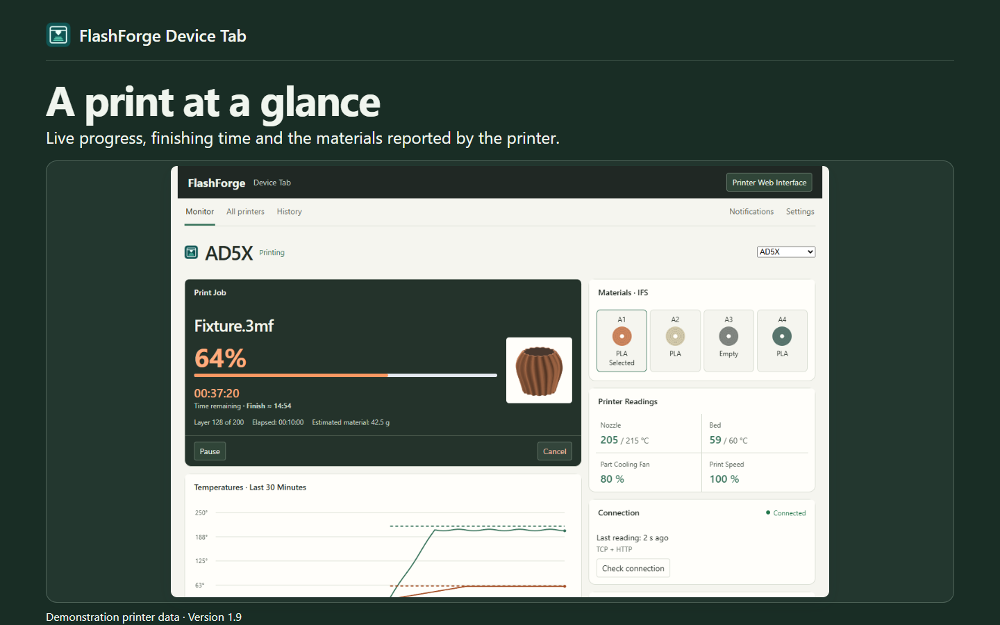
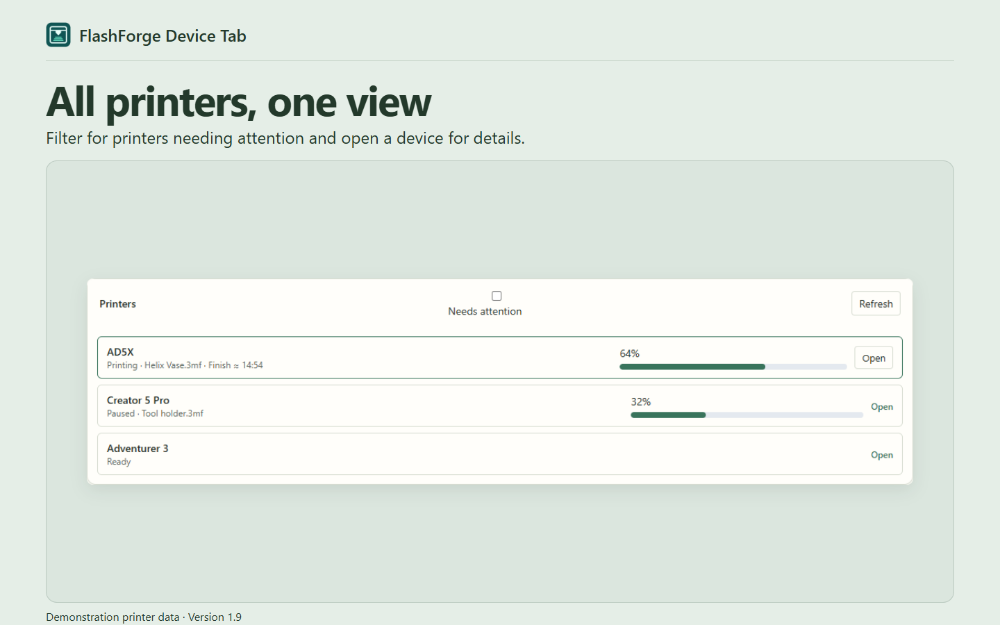
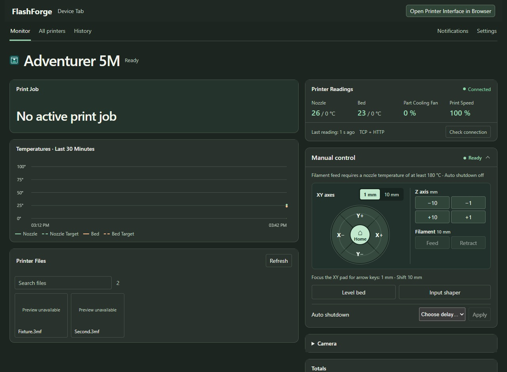

#  FlashForge Device Tab

Follow a FlashForge print from OrcaSlicer's **Device** or **FlashForge** tab. See how much time
is left, check nozzle and bed temperatures, or open the printer camera.
Switch between your local printers and review completed jobs after a restart.
Printers with a working authenticated control API also offer pause, resume and cancel.

**Stable release 1.12.1** scopes keyboard jogging to the XY pad and keeps
Manual control visible when printer readings become unavailable.

[](docs/panel.png)

| All printers | Print history |
| --- | --- |
| [](docs/02-printer-fleet.png) | [](docs/03-print-history.png) |

The screenshots show the plugin running with demonstration data. Select an image for a closer look.

## Manual control by model



| Printer | Commands in the manual panel |
| --- | --- |
| Adventurer 3, 3 Lite, 3 Pro, 3 Pro 2, 4, 4 Pro and 4 Lite | Home, XYZ jogs (1 or 10 mm), feed and retract (10 mm) via TCP. |
| Adventurer 5M and 5M Pro | Home, XYZ jogs and filament via TCP with authenticated telemetry. Level bed, input shaper and the firmware-reported shutdown timer via HTTP. |
| AD5X | Home, XYZ jogs, feed and retract when enabled by firmware, level bed, input shaper, clear the active error and the firmware-reported shutdown timer. |
| Creator 5 and Creator 5 Pro | Level bed, input shaper and the firmware-reported shutdown timer via HTTP. Stock firmware has no manual motion or extrusion API. |

Manual commands require an idle printer. Filament controls require at least
180 °C at the nozzle. Where available, the shutdown timer offers Off, 30, 60
and 120 minutes. The manual controls were verified with simulated printers.
Focus the XY pad to jog by 1 mm with the arrow keys or by 10 mm with Shift.
Press Enter on the Home button to home the printer. If readings become
unavailable, the panel stays open and commands are disabled until fresh readings arrive.

## What it does

- **Print job card** — file name, progress, remaining and elapsed time, layer.
- **Printer readings** — nozzle and bed temperature against their targets, fan
  and speed.
- **Temperatures chart** — the last 30 minutes, sampled every five seconds.
- **Camera** — the printer's MJPEG stream, if the printer exposes one.
- **Printer files** — the on-printer file list with previews, 10 per page.
- **Print history** — jobs with start, end, duration and result, kept on disk so
  it survives OrcaSlicer restarts.
- **Several printers** — every printer in the plugin settings is monitored. Open
  **All printers** to see them side by side or filter for attention, then open
  its full panel.
- **Pause, resume, cancel** — from the panel header. Cancel asks for a second
  click; nothing is sent until you confirm.
- **Printer card** — model, firmware, serial number, MAC, build volume and light
  when available.
- **Totals** — jobs, print time and success rate from the local history.
- **Save snapshot** — one camera frame, saved by the browser.
- **Host notifications** — “Print finished”, “Print cancelled”, “Printer error”
  appear in the 3D view, so you notice without watching the tab.

## Install

1. Download `flashforge_device_tab.py` from the latest release.
2. In OrcaSlicer open **Plugins → Install from file** and pick the file.
3. Enable **FlashForge Device Tab**.
4. Make sure the printer profile uses the **FlashForge** host type.
5. Open the **Device tab**. The plugin panel opens automatically for a configured
   FlashForge printer. For initial setup, use **Speed Dial → FlashForge Device Tab**.

OrcaSlicer 2.5.0 or newer, Windows x64. The plugin needs no extra software: no
Node, no Docker, no Raspberry Pi, no second application.

**Open Printer Interface in Browser** opens the printer's own web page in the
system browser and keeps the monitor open in OrcaSlicer. If an earlier release
left the Device tab on a connection error, the plugin restores the monitor
when it loads for the configured FlashForge profile.

## Settings

In **Plugins → FlashForge Device Tab → Config**, choose **Show monitor in** and
save, then restart OrcaSlicer. **Printer tab** is the default and hides the extra
tab. **FlashForge tab** adds a dedicated tab for the configured printers and
restores OrcaSlicer's original Device page for the active FlashForge profile.

Open **Settings** and enter the printer address, optional display name, CheckCode
and serial number. **Check saved connection** reads status from the saved
device. **Edit as text** accepts one printer per line:

```
192.168.1.50 | 1a2b3c4d | Adventurer 5M
192.168.1.51 | 2b3c4d5e | Creator 5 Pro | YOUR-SERIAL-NUMBER
```

`address | CheckCode | name | serial number`. The name is optional and falls
back to the address. Use the CheckCode from the printer's network settings.

- **Adventurer 5M / 5M Pro** reads the serial number over TCP. Basic monitoring
  and the file catalog work without a CheckCode. Extra telemetry and job
  controls use the CheckCode.
- **Creator 5 / 5 Pro** requires the serial number and CheckCode. Enable LAN-only
  mode on stock firmware. The Device tab can read print status, temperatures,
  available progress and time fields, file names and thumbnails. It also uses
  the existing pause, resume and cancel controls. Creator support has been
  tested with a simulated printer.

On **Creator 5 Pro**, open **Camera → Connect** to start the built-in camera.
**Save snapshot** downloads the displayed JPEG while video continues. Closing
the Device tab releases the camera. Returning to the monitor reconnects when
the Camera panel is open. Choose **Disconnect** to turn off automatic reopening.

Creator stock firmware returns a list of file names and serves thumbnails
separately. It does not report the active tool, TCP endstops, or per-file material
and time estimates. The temperature chart compares the selected tool and the bed. The readings
panel also shows T2–T4 and the Pro chamber temperature when available. The
plugin does not upload files, start prints or change material mappings.

## Other FlashForge models

| Family | Compatibility evidence and scope |
| --- | --- |
| Adventurer 3 / 4 families | Experimental TCP control for recognized models: Home, XYZ jogging and filament feed/retraction. [Adventurer 3 protocol](https://github.com/Parallel-7/flashforge-api-docs/blob/main/endpoints/networkserver_commands_adventurer3.yaml) · [Adventurer 4 protocol](https://github.com/Parallel-7/flashforge-api-docs/wiki/Adventurer-4-Series) |
| Adventurer 5M / 5M Pro | TCP motion controls plus leveling and input shaping with authenticated HTTP telemetry. [5M protocol](https://github.com/Parallel-7/flashforge-api-docs/wiki/Adventurer-5M-Series) |
| Creator 5 / 5 Pro | Leveling and input shaping over HTTP. The stock API has no manual motion, Home, extrusion or error-clear command. [Creator protocol](https://github.com/Parallel-7/flashforge-api-docs/wiki/Creator-5-Series) |
| AD5X | IFS slot monitoring, Home, XYZ jogging, filament feed/retraction, leveling, input shaping and clearing an active error. [AD5X protocol](https://github.com/Parallel-7/flashforge-api-docs/wiki/AD5X) |
| Guider 3 Ultra | FlashForge lists this printer in Flash Studio Desktop. Compatibility with this plugin's LAN requests still needs sample responses. [Vendor software page](https://www.flashforge.com/pages/flash-studio-desktop) |
| Finder | An existing Cura integration provides a starting point for research. Identify the specific Finder generation and capture its monitoring responses before adding it here. [Finder integration](https://github.com/ronoaldo/FlashforgeFinderIntegration) |

For a compatibility report, include the exact model and firmware, which readings
appeared while idle and printing, and what the panel showed when the job ended.
Remove addresses, serial numbers and CheckCodes from any shared screenshots or logs.

## How it works

OrcaSlicer shows the monitor in the Device tab when the printer profile's
`print_host_webui` points at it. The plugin runs a loopback HTTP server on
`127.0.0.1:18771` and serves the same monitor to the FlashForge tab via OrcaSlicer's
Pages capability. It tries FlashForge TCP on
port 8899 first. When that fails and the serial number and CheckCode are set,
it checks the HTTP API on port 8898 and keeps using it after a successful
status read. Creator cameras use a separate MJPEG stream on port 8080.

## Security

- Manual commands require a fresh idle-state check on the selected printer.
  Modern printers use authenticated telemetry. Legacy Adventurer motion uses
  the printer's TCP control session. The shutdown timer appears on supported
  HTTP models when the firmware reports the setting. Manual controls have been
  tested against simulated printers. Physical verification is pending.
  Filament jogging requires a reported nozzle temperature of at least 180 °C.
- Reads **only its own configuration** from OrcaSlicer; printer profiles are
  never read for credentials.
- Talks to the local network: the printers you configure, nothing else.
- Serves one page on `127.0.0.1`, checks `Host`, `Origin` and `Sec-Fetch-Site`,
  refuses framing from other origins and sends `no-store`.
- The OrcaSlicer plugin catalogue rates the plugin **low risk**.

## Development

```powershell
python -m unittest discover -s tests
node --test tests/panel-regressions.test.cjs
```

The tests use an Adventurer fixture with both transports and a Creator fixture
with HTTP only. They exercise status, files, thumbnails, job controls, LAN mode
and credential errors, history, settings and the Device page bridge.

With Chrome installed and the Playwright Node package available, run
`node tests/camera-browser.cjs` for the Creator 5 Pro camera lifecycle test.
It starts its own local printer simulator, compares the saved JPEG with the
displayed frame and checks the camera commands across closing and reopening
the browser tab.

## Releasing

1. Bump `# version` in `flashforge_device_tab.py` and add a `CHANGELOG.md` entry.
2. Commit, tag `vX.Y.Z`, push the tag.
3. Publish a GitHub release for the tag. `.github/workflows/publish-orcacloud.yml`
   uploads the plugin to the OrcaSlicer catalogue through GitHub OIDC — the tag
   becomes the published version and the release notes become the changelog.

The catalogue requires a platform suffix in the uploaded file name, so the
workflow sends `flashforge_device_tab_win_x86_64.py`.

## License

MIT. Community plugin, not affiliated with FlashForge or OrcaSlicer.
