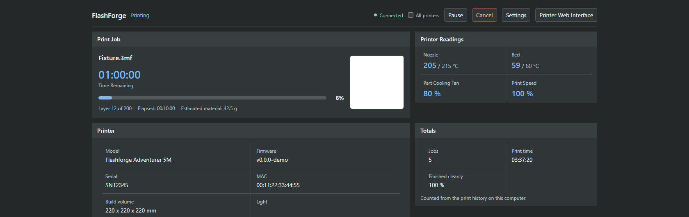

# FlashForge Device Tab

A single-file OrcaSlicer plugin that fills the empty **Device tab** for FlashForge
printers: job progress, temperatures, the printer's file list with previews, the
camera stream, a 30-minute temperature chart and a print history that survives
restarts. Read-only — it never starts, pauses or cancels a job.



## What it does

- **Print job card** — file name, progress, remaining and elapsed time, layer.
- **Printer readings** — nozzle and bed temperature against their targets, fan
  and speed.
- **Temperatures chart** — the last 30 minutes, sampled every five seconds.
- **Camera** — the printer's MJPEG stream, if the printer exposes one.
- **Printer files** — the on-printer file list with previews, 10 per page.
- **Print history** — jobs with start, end, duration and result, kept on disk so
  it survives OrcaSlicer restarts.
- **Several printers** — every printer in the plugin settings is monitored; tick
  **All printers** in the panel header to see them side by side, click one to open
  its full panel.

## Install

1. Download `flashforge_device_tab.py` from the latest release.
2. In OrcaSlicer open **Plugins → Install from file** and pick the file.
3. Enable **FlashForge Device Tab**.
4. Make sure the printer profile uses the **FlashForge** host type.
5. Open **Device tab → Speed Dial → FlashForge Device Tab**.

OrcaSlicer 2.5.0 or newer, Windows x64. The plugin needs no extra software: no
Node, no Docker, no Raspberry Pi, no second application.

## Settings

Press **Settings** in the panel header. One printer per line:

```
192.168.3.37 | 03dd42ee | Adventurer 5M
192.168.3.10 | 1a2b3c4d | Adventurer 5M #2
```

`address | CheckCode | name`. The name is optional and falls back to the address.
The CheckCode is the one in the printer's own network settings; without it the
panel cannot show the remaining time, filament estimate or camera address — the
rest still works.

## How it works

OrcaSlicer shows a plugin page in the Device tab when the printer profile's
`print_host_webui` points at it. The plugin runs a loopback HTTP server on
`127.0.0.1:18771`, speaks the FlashForge TCP protocol on port 8899 and the
printer's HTTP API on 8898, and renders a single HTML page. Everything is one
Python file that ships its own HTML, CSS and JavaScript.

## Security

- Reads **only its own configuration** from OrcaSlicer; printer profiles are
  never read for credentials.
- Talks to the local network: the printers you configure, nothing else.
- Serves one page on `127.0.0.1`, checks `Host`, `Origin` and `Sec-Fetch-Site`,
  refuses framing from other origins and sends `no-store`.
- The OrcaSlicer plugin catalogue rates the plugin **low risk**.

## Development

```powershell
python -m unittest discover -s tests
```

The tests start a fake FlashForge printer (TCP 8899 + HTTP 8898) and exercise the
protocol client, the history file, the loopback server's guards, the settings
endpoint and the page bridge.

## Releasing

1. Bump `# version` in `flashforge_device_tab.py` and add a `CHANGELOG.md` entry.
2. Commit, tag `vX.Y.Z`, push the tag.
3. Publish a GitHub release for the tag. `.github/workflows/publish-orcacloud.yml`
   uploads the plugin to the OrcaSlicer catalogue through GitHub OIDC — the tag
   becomes the published version and the release notes become the changelog.

The catalogue requires a platform suffix in the uploaded file name, so the
workflow sends `flashforge_device_tab_win_x86_64.py`.

## License

MIT. Community plugin, not affiliated with FlashForge or OrcaSlicer.
