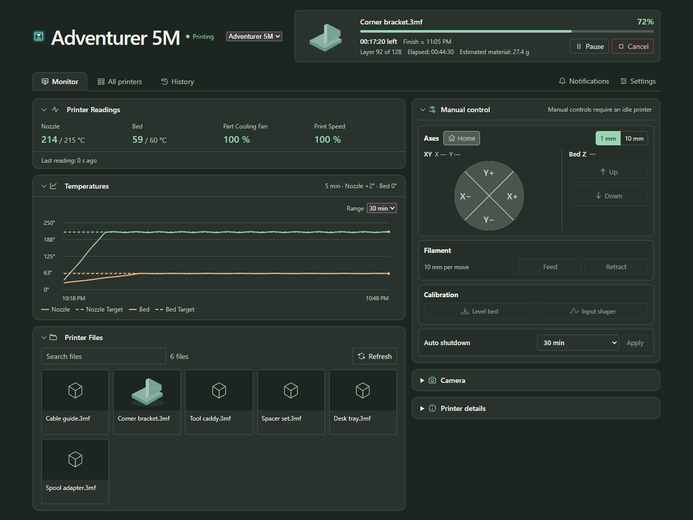
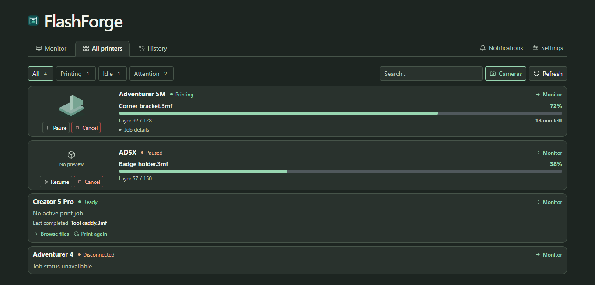
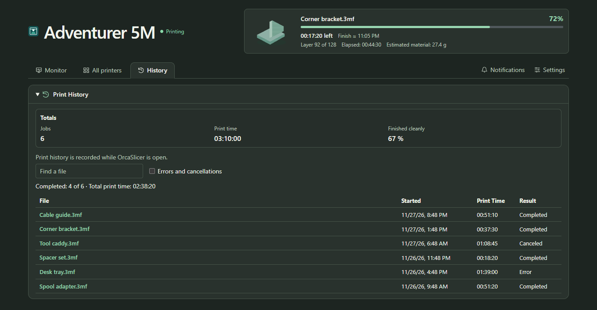
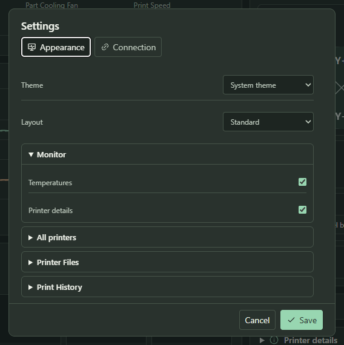
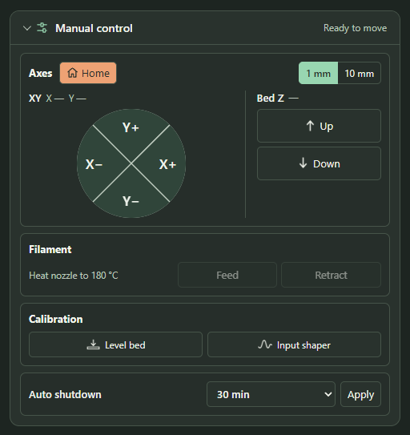
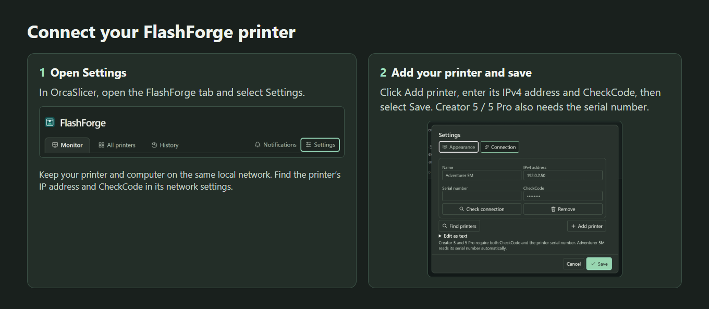

Follow your FlashForge prints inside OrcaSlicer. The FlashForge tab shows progress, time remaining, nozzle and bed temperatures, printer files and supported manual controls. It also supports cameras on compatible models. The plugin connects to your printer over the local network.

## Monitor

See the current job, temperatures, files and available controls in one place. Pause, resume and cancel are available on supported printers.

## All printers

See every configured printer in a vertical list. Search by printer or job, or filter by status. Active jobs show progress, a model preview and a live camera where available. You can turn off camera playback for the whole list. Open stored files or repeat the last completed job from a ready printer's row.

## History

See print times and outcomes, search for a file, or filter for errors and cancellations. The history is stored locally.

## Appearance

Choose the theme and layout density, then show or hide blocks for each view in Settings.

## Manual control

Supported idle printers show Home, XY and Z movement, filament controls or calibration, depending on the model.

## Connect a printer

1. With the plugin enabled, open **FlashForge → Settings** in OrcaSlicer.
2. Click **Add printer**, enter the printer’s IPv4 address and CheckCode, then click **Save**. Creator 5 and 5 Pro also require the serial number.

Your printer and computer need to be on the same local network. For basic monitoring of Adventurer 5M and 5M Pro, the address is enough. The CheckCode enables additional readings and supported controls.

Screenshots use demonstration data. Requires OrcaSlicer 2.5.0 or newer on Windows x64.

[Source, installation and model compatibility](https://github.com/UshMask/flashforge-device-tab)
